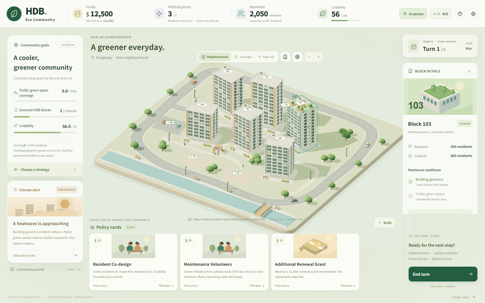

# HDB Eco Community

A browser-based serious game about making an existing HDB neighbourhood greener, cooler, and financially sustainable. Plan public green spaces, retrofit residential blocks, and use policy cards before a heatwave and the final project inspection.

**[Play online](https://hdb-eco-community.bluebirdstory.chatgpt.site/)** · **[Quick play guide / 简明游玩指南](docs/PLAY_GUIDE.md)** · **[Design notes (中文)](docs/DESIGN_NOTES_ZH.md)**

The game starts in **English**. Switch to **中文** at any time using the language button; your browser remembers your choice.



## How to play

1. Choose a strategy, then inspect the residential blocks and available plots on the 3D map.
2. Green residential blocks and place parks or shaded walkways. Check the cost and newly served residents before confirming construction.
3. Use policy cards when their benefits fit your plan. Cards spend political points; ordinary construction spends funds.
4. Open **AI advisor** to compare feasible plans and explore why they produce different outcomes.
5. Press **End turn** to settle income, upkeep, and scheduled repayments. Prepare for the heatwave at the **end of turn 6**.
6. Meet all three inspection goals by the **end of turn 8**:

| Goal | Required result |
| --- | --- |
| Public green space coverage | At least **70%** of residents |
| Greened HDB blocks | At least **4** blocks |
| Community livability | At least **75** |

If the inspection is missed, the game offers two remedial turns. Parks and walkways provide public coverage; rooftop greening benefits its own block. Overlapping public services count each resident only once.

Click a block or plot to inspect it, drag to pan, and scroll to zoom. The neighbourhood roster is an alternative way to select sites. Use the **Coverage** and **Heat risk** layers to plan, and open **Funds** to review operating costs and debt. See the [play guide](docs/PLAY_GUIDE.md) for a short first-session walkthrough.

## Features and learning focus

- **Procedural Three.js neighbourhood:** varied building orientations, curved roads, landscaping, selectable plots, and visible construction changes.
- **Spatial planning:** population-weighted coverage, service overlap, and construction previews make location matter.
- **Resource trade-offs:** construction costs, facility upkeep, political points, financing, and heatwave response compete for limited resources.
- **Explainable outcomes:** the heatwave report records each block's residents and indoor/outdoor exposure at the time of the event.
- **English and Chinese:** interface, policy cards, advisor feedback, and historical reports can switch languages without restarting.
- **Local saves:** actions, turn endings, and reflection answers save automatically. Saves belong to the current browser and site; they do not sync between devices.

### Serious-game AI

The **AI advisor** uses local, bounded planning search and the actual game rules to compare legal sequences of up to three actions in the current turn. Players can choose a balanced, coverage, heat, or finance focus and inspect changes in coverage, served residents, upkeep, cash, and debt.

Recommendations explain their consequences. **Inspect first step** selects a target or opens a policy dialog; players still confirm the action themselves. Adaptive reflection questions provide feedback on the current planning problem and record practice answers separately from the city score.

This is a local planning AI, with **no external model, API key, or paid service required**. It does not predict future card draws, simulate future turn settlements, or guarantee an optimal complete-game strategy. The learning questions are practice feedback; learning effectiveness still needs evaluation with players.

## Run locally

Install **Node.js 22 or newer** and use a WebGL-capable browser.

```sh
git clone https://github.com/CDE5311-Aug2026/team-4.git
cd team-4
corepack enable
pnpm install --frozen-lockfile
pnpm dev
```

Open the local URL printed by the development server, normally `http://127.0.0.1:5173/`. Access to this repository is required to clone it while it remains private.

The project pins `pnpm` in `package.json`. If Corepack is unavailable, install that pnpm version using `npm install --global pnpm@11.25.0`. Alternatively, `npm install` and `npm run dev` can run the project; pnpm is preferred for reproducing the committed lockfile.

```sh
pnpm test       # Run the game, language, and advisor tests
pnpm build      # Generate the production site in dist/
pnpm preview    # Preview the production build locally
```

The game needs no environment variables or backend. Its scene, icons, and policy illustrations are generated in code; gameplay does not depend on remote images or fonts.

## Deployment

The current public build is available at [hdb-eco-community.bluebirdstory.chatgpt.site](https://hdb-eco-community.bluebirdstory.chatgpt.site/). Uploading to this repository does not automatically update that hosted build.

For another static host, run `pnpm build` and publish the contents of `dist/`. The default build assumes hosting at the domain root. For a subdirectory such as GitHub Pages at `/team-4/`, build with the appropriate base path:

```sh
pnpm build --base=/team-4/
```

No hosting account, deployment configuration, or API credentials are included in the source.

## Project structure

| Path | Purpose |
| --- | --- |
| `src/game.js` | Game state, policies, construction, finance, heatwave, and inspection rules |
| `src/layout.js` | Shared spatial layout and migration of older saves |
| `src/scene.js` | Procedural Three.js scene, picking, overlays, and map controls |
| `src/main.js`, `src/style.css` | User interface, dialogs, responsive layout, and saving |
| `src/ui-locale.js`, `src/engine-locale.js` | Interface and game-content translations |
| `src/advisor.js`, `src/advisor-view.js` | Planning search, evidence, and adaptive reflection |
| `src/icons.js`, `public/` | Icons, illustrations, and favicon |
| `tests/` | Automated rule, localization, and advisor checks |
| `docs/PLAY_GUIDE.md` | Simple English and Chinese play introduction |
| `docs/DESIGN_NOTES_ZH.md` | Detailed design analysis and prototype rules |

Built with **Three.js 0.180.0**, **Vite 6.3.6**, and JavaScript modules. The test suite contains **28 passing checks**, including legal construction, deduplicated coverage, heatwave snapshots, financing, recovery, save migration, bilingual output, and reproducible advisor evidence. The production build has also been verified.

## Scope

This prototype implements one playable neighbourhood-renewal scenario based on *HDB Eco Community GDD V1.0*. The concept illustration informed its atmosphere and information hierarchy. Energy simulation, clean-power systems, stormwater scenarios, new housing, and a multi-stage campaign are future work.

Costs, service radii, and heat effects are game-balance parameters, not measurements or official HDB planning guidance. The game is a student project and is not an official HDB product. The prototype's design analysis is documented in [中文设计说明](docs/DESIGN_NOTES_ZH.md).
